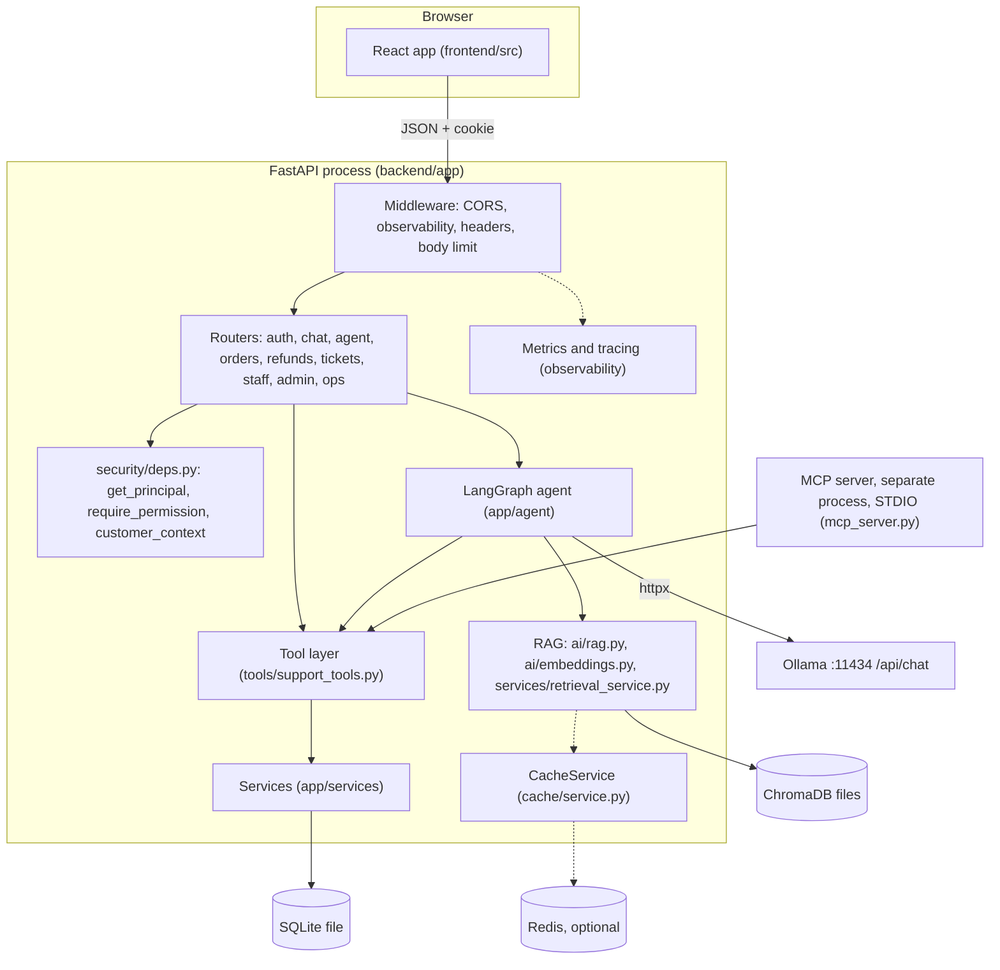
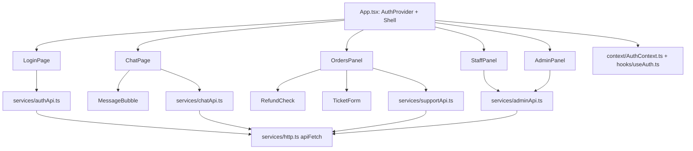
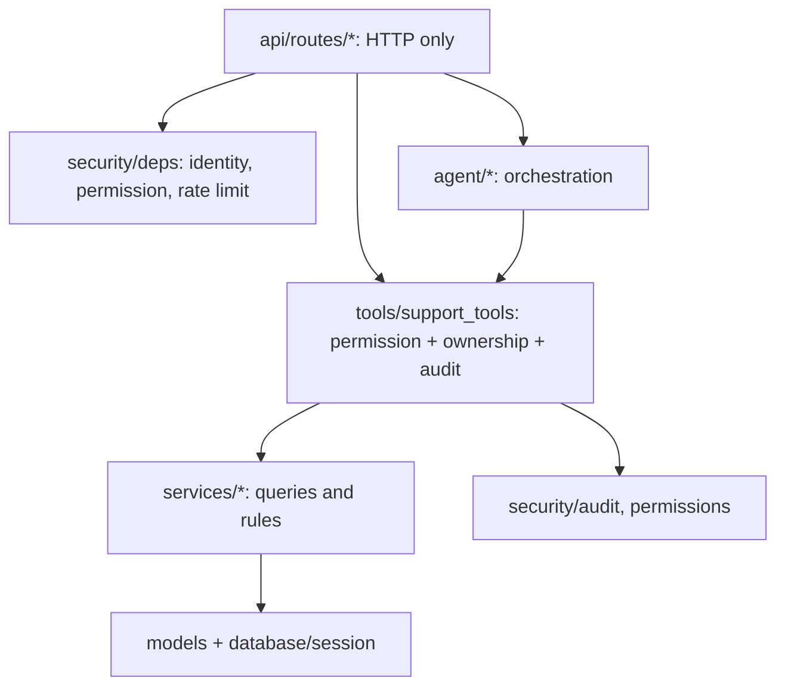
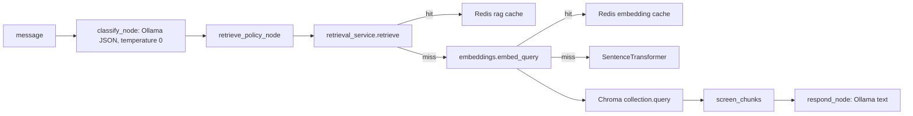
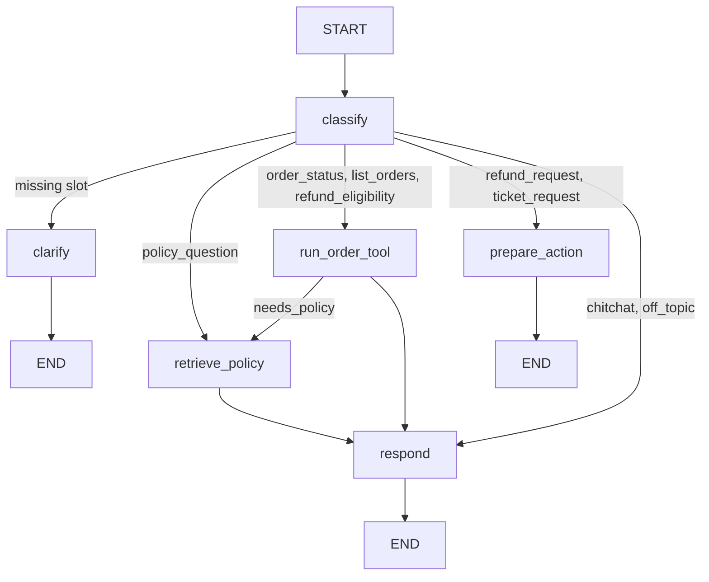
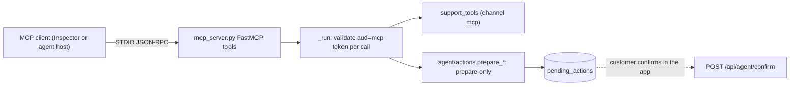
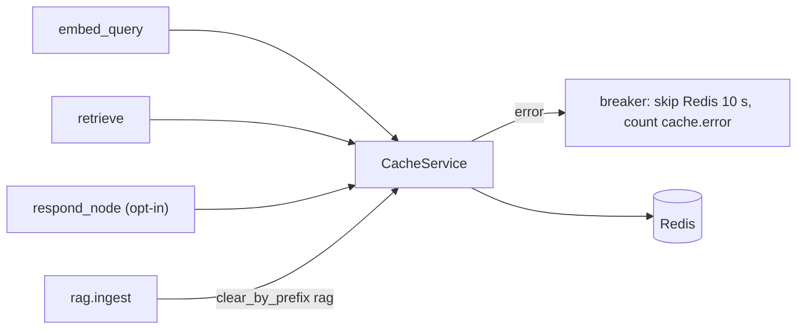
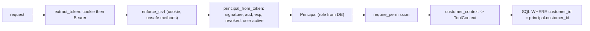

# 1. System architecture

## 1.1 Overall diagram

## 1.2 Components
| Component | Responsibility and why | Technology | Key files | Receives → produces | Depended on by |
|---|---|---|---|---|---|
| Frontend | Login, chat, orders, staff and admin screens; never trusts itself for authorization | React + TypeScript + Vite | `frontend/src/App.tsx`, `frontend/src/services/http.ts` | user input → HTTP requests; renders JSON | users |
| Backend API | Validates requests, authenticates, routes to tools/agent | FastAPI, Pydantic | `backend/app/main.py`, `backend/app/api/routes/agent.py` | HTTP → JSON | frontend |
| Auth and RBAC | Identity from a validated token, central permissions | Argon2, PyJWT | `backend/app/security/deps.py`, `backend/app/security/permissions.py` | cookie/bearer → `Principal` | every protected route, tools, MCP |
| Agent | Classifies intent, gathers data, prepares actions, phrases answers | LangGraph | `backend/app/agent/graph.py`, `backend/app/agent/nodes.py` | message + context → `AgentChatResponse` | `routes/agent.py`, eval harness |
| LLM | Language understanding (classification) and phrasing | Ollama via httpx | `backend/app/services/llm_service.py` | messages → text/JSON | agent, legacy chat |
| RAG | Policy knowledge: chunk, embed, store, retrieve | ChromaDB, sentence-transformers | `backend/app/ai/rag.py`, `backend/app/ai/embeddings.py`, `backend/app/services/retrieval_service.py` | question → ranked `RetrievedChunk` list | agent, legacy chat |
| Database | Source of truth for orders, refunds, tickets, users, audit | SQLite + SQLAlchemy 2 | `backend/app/models/entities.py`, `backend/app/database/session.py` | queries → rows | services, tools |
| Tool layer | Permission, ownership, audit, metrics for customer operations | plain Python | `backend/app/tools/support_tools.py` | typed input + `ToolContext` → `ToolResult` | REST routes, agent, MCP |
| Business rules | Deterministic refund eligibility | plain Python | `backend/app/services/refund_eligibility_service.py` | order + reason → `EligibilityResult` | tools |
| MCP server | Same tools over the Model Context Protocol | MCP SDK 1.x (`FastMCP`) | `backend/app/mcp_server.py` | JSON-RPC over STDIO → tool results | external MCP clients |
| Cache | Optional speed-up for embeddings, retrieval, opt-in answers | Redis (redis-py) | `backend/app/cache/service.py` | key material → JSON or miss | embeddings, retrieval, agent |
| Observability | Trace ids, spans, metrics, request log | stdlib | `backend/app/observability/metrics.py`, `backend/app/observability/middleware.py` | requests → log lines, counters | admin metrics endpoint |
| Evaluation | Repeatable quality and rule checks | scripts + JSON | `backend/evals/run.py`, `backend/evals/bench.py` | datasets → reports | developers |

## 1.3 Frontend architecture

`Shell` (in `frontend/src/App.tsx`) chooses the screens by `user.role`; the backend enforces the same rules independently. `frontend/src/main.tsx` comes from the Vite template (content **unverified**).

## 1.4 Backend architecture (layers)

Rule of the codebase: routes contain no business logic; tools are the single choke point for customer operations.

## 1.5 AI / LLM and RAG architecture

Ingestion (offline): `backend/app/ai/rag.py::ingest` reads `data/policies/*.md`, chunks by `##` section, embeds with `embed_texts`, upserts to Chroma, writes the index version file, purges the `rag` cache namespace.

## 1.6 Database architecture
See the ER diagram in [05-data-flow.md](05-data-flow.md). Eight tables: `customers`, `orders`, `refund_requests`, `support_tickets`, `pending_actions`, `users`, `revoked_tokens`, `audit_logs`, created by `backend/app/database/session.py::init_db` (`create_all`, no migrations).

## 1.7 LangGraph orchestration

Built in `backend/app/agent/graph.py::build_graph`. No loops: a turn runs at most one tool, one retrieval and two LLM calls.

## 1.8 MCP architecture

The MCP process is separate from the API process and opens SQLite directly. It shares the in-process code, not the API.

## 1.9 Redis caching architecture

Namespaces: `embedding`, `rag`, `llm`. SQLite and ChromaDB remain the sources of truth; eligibility, authorization and customer data are never cached.

## 1.10 Authentication and authorization

## 1.11 External and local dependencies
| Dependency | Link | Used by |
|---|---|---|
| Ollama | HTTP to `OLLAMA_BASE_URL` `/api/chat` (httpx) | `backend/app/services/llm_service.py` |
| sentence-transformers / PyTorch | in-process | `backend/app/ai/embeddings.py` |
| ChromaDB | in-process `PersistentClient` on disk | `backend/app/ai/rag.py::get_client` |
| SQLite | in-process file via SQLAlchemy | `backend/app/database/session.py` |
| Redis | TCP via redis-py pool, 0.25 s timeouts | `backend/app/cache/service.py` |
| MCP client | STDIO JSON-RPC | `backend/app/mcp_server.py` |
| Browser | HTTP, cookie `sp_session` | `frontend/src/services/http.ts` |