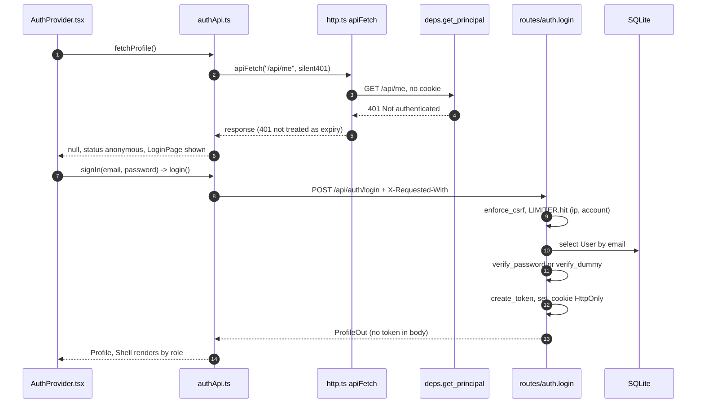
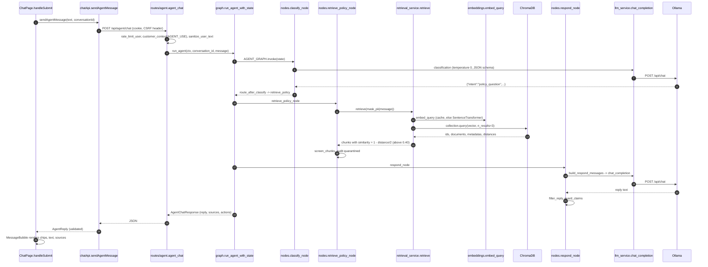
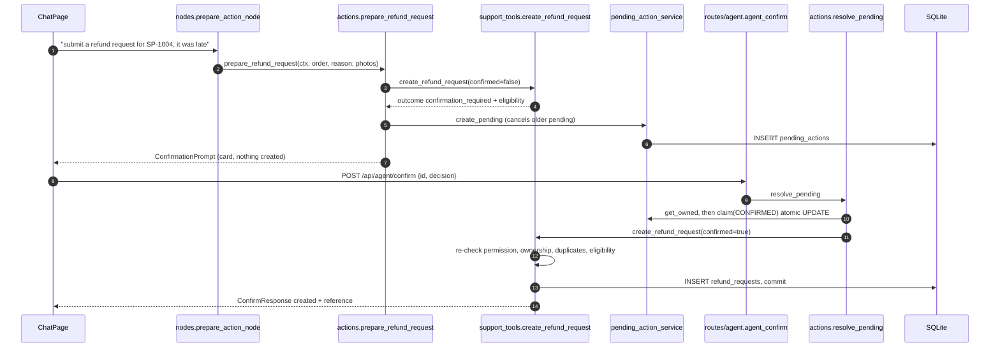
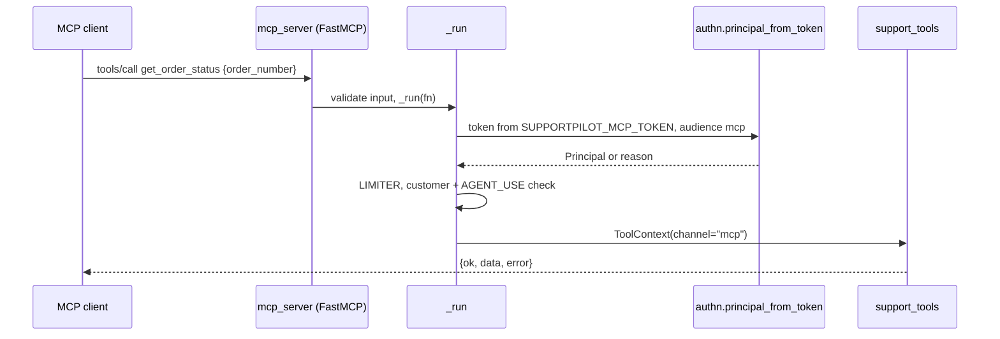
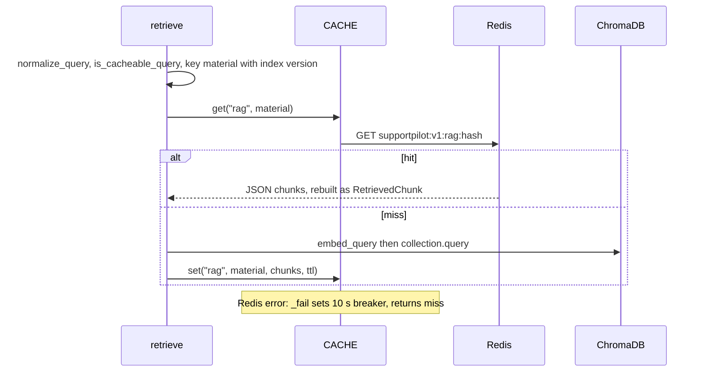

# 2. End-to-end flows

Notation: `path::symbol`. Every step below was traced from the code; where an SDK's internal behaviour is involved it is marked **unverified**.

## Flow 1: Open the app and authenticate

Details: `backend/app/api/routes/auth.py::login` returns the same 401 text for an unknown user, a wrong password and an inactive account; each writes an `auth.login` audit row. `frontend/src/components/AuthProvider.tsx::AuthProvider` registers `setUnauthorizedHandler` so any later 401 flips the app back to the login page.

## Flows 2-8: A policy question (message → RAG → Ollama → render)

Step notes:
1. `ChatPage.handleSubmit` appends the user bubble, then calls `sendAgentMessage`, which calls `post` → `apiFetch` with `timeoutMs 240000`.
2. Middleware order (outermost first): CORS, `ObservabilityMiddleware` (trace id), `SecurityHeadersMiddleware`, `BodySizeLimitMiddleware`, then the router.
3. `customer_context(Permission.AGENT_USE)` runs `get_principal` → `require_permission` → loads `Customer` → builds `ToolContext(channel="api")`; the route re-creates it with `channel="agent"`.
4. `classify_node` → `_classify_with_llm` → `chat_completion(..., json_schema=CLASSIFICATION_SCHEMA)`.
5. Embeddings: `embed_query` normalises (lowercase, collapse whitespace), checks Redis `embedding`, else `embed_texts` (`SentenceTransformer.encode`, normalised 384-d).
6. Observed during development (your pasted output): the question "How long do I have to report a damaged parcel?" ranked `damaged_parcel_policy.md / Reporting deadline` first at similarity 0.6603.
7. The reply is the model's text after `filter_reply` and `guard_claims`; `sources` are the retrieved sections, not proof the model used them.

## Flow 9: Order status
`classify_node` (intent `order_status`, order from `parse_order_number`) → `route_after_classify` → `run_order_tool_node` → `support_tools.get_order_status` → `_allowed(ORDERS_READ_OWN)` → `_owned_order` → `order_service.get_order` (SQL `WHERE customer_id = ? AND order_number = ?`) → `order_service.build_tracking` → `ToolResult` → `_record` → `respond_node` (the LLM phrases `tool_results`). A foreign order (SP-3001) returns `ORDER_NOT_FOUND`; `audit.record_denied_lookup` logs it; the user sees a generic "not found".

## Flow 10: Refund eligibility
Same path with intent `refund_eligibility` and `support_tools.check_refund_eligibility` → `refund_eligibility_service.check_eligibility` → `EligibilityResult` (eligible true/false/None, reason, amount, rule code, next action). The LLM only explains it. Example: SP-1004 + `late_express` → eligible, 2500 cents, `LATE_EXPRESS_ELIGIBLE` (verified by you in Milestone 3 and Step 5).

## Flow 11: Customer requests and confirms a refund

The confirm route uses no LLM. A second confirm returns `already_resolved`; an expired one returns `expired` (`utcnow() > action.expires_at`); another customer's id returns `not_found` because `get_owned` filters by `customer_id`.

## Flow 12: Support ticket
Single message ("open a ticket for SP-1012: tracking has not updated...") goes `classify_node` → `prepare_action_node` → `prepare_support_ticket` → `create_support_ticket(confirmed=False)` → pending action → card → confirm → `create_support_ticket(confirmed=True)` → `ticket_service.create_ticket`. If the description is missing, `classify_node` sets `missing="description"`, `clarify_node` stores `next_slots` (`awaiting`), and the next turn `_fill_awaiting` takes the whole message as the description (min 10 characters). A duplicate open ticket (same order and category) returns `DUPLICATE_TICKET`, backed by the partial unique index `uq_open_ticket_per_order_category`.

## Flow 13: MCP tool invocation

`create_refund_request` and `create_support_ticket` call `actions.prepare_*` and return a `confirmation_id` (`mcp_server.py::_prepared`); they never write. Staff or admin tokens get `FORBIDDEN`. The MCP SDK's own transport and error wrapping are **unverified** here.

## Flow 14: Redis cache hit and miss

Queries containing an order/ticket reference or masked PII are never cached (`embeddings.py::is_cacheable_query`). Ingest changes the index version and calls `CACHE.clear_by_prefix("rag")`.

## Flow 15: Errors and fallbacks
| Situation | Path | User sees |
|---|---|---|
| Invalid body | FastAPI/Pydantic 422 | `errorMessage` text in `frontend/src/services/http.ts` |
| No/expired session | `get_principal` 401 | `UnauthorizedError`, login page with "session has ended" |
| Ollama down | `llm_service.py::_service_error` → `LLMServiceError(503)` → `HTTPException` in `agent_chat` | error banner |
| Ollama timeout | `httpx.TimeoutException` → 504 | error banner |
| Ollama bad JSON for classification | `_classify_with_llm` falls back to `parsing.py::heuristic_intent` | normal answer |
| Empty vector store | `KnowledgeBaseEmptyError` caught in `retrieve_policy_node` | model told "no relevant policy found" |
| Redis down | `CACHE._fail` | normal answer, slower |
| Tool error | `ToolResult(ok=False)` | explained in plain language |
| Unhandled exception | `main.py::unhandled_error` | generic 500 JSON with a trace id in the log |