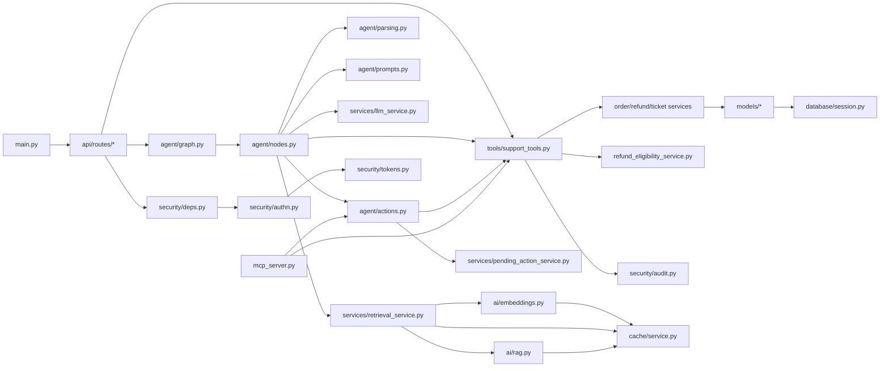
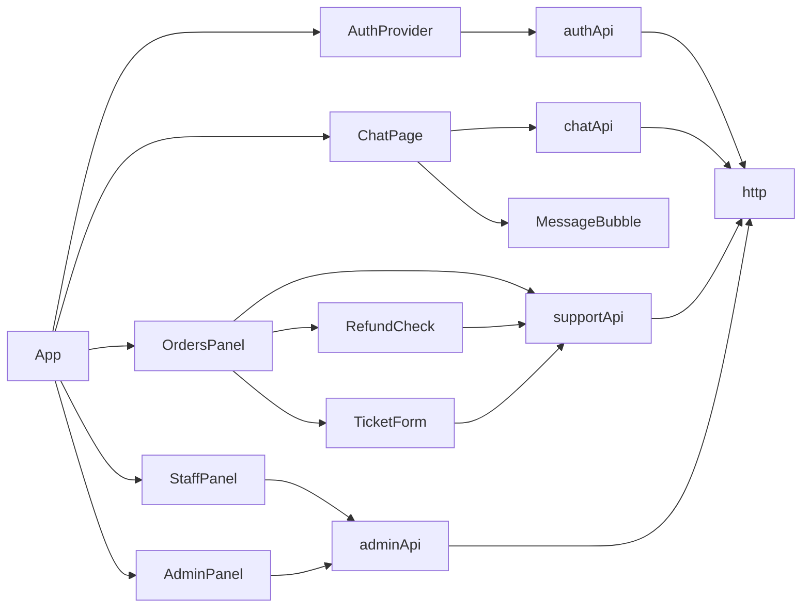

# 3. Codebase map

## 3.1 Backend dependency diagram

## 3.2 Frontend dependency diagram

## 3.3 Backend files (`backend/app`)
| File | Purpose and key symbols | Notable internal imports | Position in flow |
|---|---|---|---|
| [`main.py`](../../backend/app/main.py) | App assembly: `lifespan`, middleware order, routers, `unhandled_error`, `/health` | all routers, `security.middleware`, `observability.*`, `cache.service` | entry point |
| [`core/config.py`](../../backend/app/core/config.py) | `Settings` (env-driven), `validate_for_serving`, `cors_origin_list` | pydantic-settings | read by everything |
| [`core/prompts.py`](../../backend/app/core/prompts.py) | legacy chat `SYSTEM_PROMPT`, `NO_POLICY_FOUND` | none | legacy chat, agent prompts |
| [`database/session.py`](../../backend/app/database/session.py) | `Base`, `utcnow`, `engine`, FK pragma listener, `SessionLocal`, `get_db`, `init_db` | `core.config` | every DB access |
| [`database/seed.py`](../../backend/app/database/seed.py) | `seed`, `scenario_specs`, `filler_specs`, `_ensure_*` | `models` | `python -m app.database.seed` |
| [`models/entities.py`](../../backend/app/models/entities.py) | enums, `Customer`, `Order`, `RefundRequest`, `SupportTicket`, `_enum` | `database.session` | ORM |
| [`models/auth.py`](../../backend/app/models/auth.py) | `UserRole`, `User`, `RevokedToken`, `AuditLog` | `entities._enum` | auth, audit |
| [`models/pending_action.py`](../../backend/app/models/pending_action.py) | `PendingAction`, status/type enums | `entities._enum` | confirmations |
| [`schemas/*.py`](../../backend/app/schemas/tools.py) | Pydantic I/O models (`tools.py` is the tool contract; `agent.py`, `auth.py`, `ops.py`, `orders.py`, `refunds.py`, `tickets.py`, `chat.py`, `common.py`) | `models` | validation and responses |
| [`services/order_service.py`](../../backend/app/services/order_service.py) | `get_order`, `list_orders`, `build_tracking`, `to_summary`, `to_detail` | `models`, `schemas.orders` | tools, routes |
| [`services/refund_service.py`](../../backend/app/services/refund_service.py) | `find_active_request`, `status_for`, `create_refund_request`, `get_request` | `models` | tools |
| [`services/ticket_service.py`](../../backend/app/services/ticket_service.py) | `find_open_ticket`, `create_ticket`, `get_ticket`, `list_tickets` | `models` | tools, routes |
| [`services/pending_action_service.py`](../../backend/app/services/pending_action_service.py) | `create_pending`, `get_owned`, `claim`, `set_status` | `models`, `core.config` | `agent/actions.py` |
| [`services/refund_eligibility_service.py`](../../backend/app/services/refund_eligibility_service.py) | `check_eligibility` and per-reason checks, `add_business_days`, `usd` | `models`, `schemas.refunds` | tools |
| [`services/llm_service.py`](../../backend/app/services/llm_service.py) | `LLMServiceError`, `generate_reply` (async, legacy), `chat_completion` (sync, agent), `build_user_prompt` | `core.prompts`, `observability.metrics` | Ollama access |
| [`services/retrieval_service.py`](../../backend/app/services/retrieval_service.py) | `retrieve`, `needs_policy_lookup`, `RetrievedChunk`, `KnowledgeBaseEmptyError` | `ai.embeddings`, `ai.rag`, `cache.service` | RAG query side |
| [`ai/rag.py`](../../backend/app/ai/rag.py) | chunking, `ingest`, `get_collection`, index version | `ai.embeddings`, `cache.service`, chromadb | RAG ingest side |
| [`ai/embeddings.py`](../../backend/app/ai/embeddings.py) | `get_model`, `embed_texts`, `embed_query`, `normalize_query`, `is_cacheable_query` | `cache.service` | RAG |
| [`ai/agent.py`](../../backend/app/ai/agent.py) | **Empty placeholder** (the real agent is `app/agent/`) | none | unused |
| [`agent/state.py`](../../backend/app/agent/state.py) | `Intent`, `CLASSIFICATION_SCHEMA`, `AgentState` | `retrieval_service`, `support_tools` | graph state |
| [`agent/nodes.py`](../../backend/app/agent/nodes.py) | graph nodes and routers | many (see 3.1) | agent |
| [`agent/graph.py`](../../backend/app/agent/graph.py) | `build_graph`, `AGENT_GRAPH`, `run_agent_with_state`, `run_agent` | `nodes`, `memory` | called by route and evals |
| [`agent/parsing.py`](../../backend/app/agent/parsing.py) | regex extraction (`parse_order_number`, `parse_photos`, `parse_reason`, `parse_category`) and `heuristic_intent` | `agent.state` | classify |
| [`agent/prompts.py`](../../backend/app/agent/prompts.py) | classifier and agent prompts, `build_*_messages`, `guard_claims`, `humanize`, `neutralize` | `security.ai_safety`, `security.pii` | LLM input |
| [`agent/memory.py`](../../backend/app/agent/memory.py) | `MemoryStore`, `ConversationMemory`, `MEMORY` (in-process) | none | multi-turn state |
| [`agent/actions.py`](../../backend/app/agent/actions.py) | `prepare_refund_request`, `prepare_support_ticket`, `resolve_pending` | `support_tools`, `pending_action_service` | confirmation |
| [`tools/support_tools.py`](../../backend/app/tools/support_tools.py) | `ToolContext` and the five tools | services, `security.*` | choke point |
| [`security/deps.py`](../../backend/app/security/deps.py) | `get_principal`, `enforce_csrf`, `require_permission`, `customer_context`, `rate_limit_user` | `authn`, `tokens`, `audit` | every protected route |
| [`security/authn.py`](../../backend/app/security/authn.py) | `principal_from_token` | `tokens`, `models` | API and MCP |
| [`security/tokens.py`](../../backend/app/security/tokens.py) | `create_token`, `decode_token`, `revoke_token` | PyJWT | login, logout |
| [`security/passwords.py`](../../backend/app/security/passwords.py) | Argon2 helpers, `validate_password_strength` | argon2-cffi | login, admin |
| [`security/permissions.py`](../../backend/app/security/permissions.py) | `Permission`, `ROLE_PERMISSIONS`, `has_permission` | `models` | RBAC |
| [`security/ai_safety.py`](../../backend/app/security/ai_safety.py) | `sanitize_user_text`, `filter_reply`, `screen_chunks`, `CANARY` | `pii` | agent, legacy chat |
| [`security/pii.py`](../../backend/app/security/pii.py) | `mask_pii`, `redact_secrets`, `mask_email` | none | prompts, logs, staff views |
| [`security/audit.py`](../../backend/app/security/audit.py) | `record`, `record_denied_lookup`, `list_events` | `models`, `SessionLocal` | everywhere |
| [`security/rate_limit.py`](../../backend/app/security/rate_limit.py) | `SlidingWindowLimiter`, `LIMITER`, `client_ip` | none | login, user limits |
| [`security/middleware.py`](../../backend/app/security/middleware.py) | `BodySizeLimitMiddleware`, `SecurityHeadersMiddleware` | starlette | main |
| [`security/logging_filter.py`](../../backend/app/security/logging_filter.py) | `install_redaction` | `pii` | main, MCP |
| [`security/manage.py`](../../backend/app/security/manage.py) | user CLI (`create-user`, `seed-dev-users`, `list-users`) | `passwords` | setup |
| [`cache/service.py`](../../backend/app/cache/service.py) | `CacheService`, `CACHE` | redis-py | embeddings, retrieval, agent |
| [`observability/metrics.py`](../../backend/app/observability/metrics.py) | `Registry`, `span`, `record`, `note`, trace context, `instrument_tool` | none | everywhere |
| [`observability/middleware.py`](../../backend/app/observability/middleware.py) | `ObservabilityMiddleware`, `setup_request_logging` | `metrics`, `pii` | main |
| [`observability/db.py`](../../backend/app/observability/db.py) | `install_db_timing` (SQLAlchemy events) | `database.session` | main |
| [`mcp_server.py`](../../backend/app/mcp_server.py) | five MCP tools, `_run`, `_prepared`, `main` | `actions`, `authn`, `support_tools` | MCP process |
| Routes | [`auth.py`](../../backend/app/api/routes/auth.py), [`chat.py`](../../backend/app/api/routes/chat.py), [`agent.py`](../../backend/app/api/routes/agent.py), [`orders.py`](../../backend/app/api/routes/orders.py), [`refunds.py`](../../backend/app/api/routes/refunds.py), [`tickets.py`](../../backend/app/api/routes/tickets.py), [`staff.py`](../../backend/app/api/routes/staff.py), [`admin.py`](../../backend/app/api/routes/admin.py), [`ops.py`](../../backend/app/api/routes/ops.py) | see doc 11 of the main docs | HTTP surface |

Evaluation: [`evals/common.py`](../../backend/evals/common.py) (temporary database, helpers, reports), [`evals/run.py`](../../backend/evals/run.py) (rag, llm, agent, business suites), [`evals/bench.py`](../../backend/evals/bench.py) (component benchmark), datasets under `backend/evals/datasets/`.

## 3.4 Frontend files (`frontend/src`)
| File | Purpose |
|---|---|
| [`App.tsx`](../../frontend/src/App.tsx) | `App` (provider) and `Shell` (role-based screens and tabs) |
| [`services/http.ts`](../../frontend/src/services/http.ts) | `apiFetch` (cookie, CSRF header, timeout, 401 handler), `errorMessage`, `getJson`, `sendJson` |
| [`services/chatApi.ts`](../../frontend/src/services/chatApi.ts) | `sendAgentMessage`, `resolveConfirmation` with response validation |
| [`services/supportApi.ts`](../../frontend/src/services/supportApi.ts) | orders, tracking, eligibility, refund and ticket calls (`postTool`) |
| [`services/authApi.ts`](../../frontend/src/services/authApi.ts), [`adminApi.ts`](../../frontend/src/services/adminApi.ts) | login/logout/profile; staff and admin calls |
| [`components/AuthProvider.tsx`](../../frontend/src/components/AuthProvider.tsx), [`context/AuthContext.ts`](../../frontend/src/context/AuthContext.ts), [`hooks/useAuth.ts`](../../frontend/src/hooks/useAuth.ts) | session state |
| [`pages/ChatPage.tsx`](../../frontend/src/pages/ChatPage.tsx), [`components/MessageBubble.tsx`](../../frontend/src/components/MessageBubble.tsx) | chat, action chips, confirmation card, policy sources |
| [`components/OrdersPanel.tsx`](../../frontend/src/components/OrdersPanel.tsx), [`RefundCheck.tsx`](../../frontend/src/components/RefundCheck.tsx), [`TicketForm.tsx`](../../frontend/src/components/TicketForm.tsx) | customer self-service with preview-then-confirm |
| [`components/StaffPanel.tsx`](../../frontend/src/components/StaffPanel.tsx), [`AdminPanel.tsx`](../../frontend/src/components/AdminPanel.tsx) | staff and admin screens |
| `frontend/src/types/*.ts`, `frontend/src/utils/format.ts` | shared types and formatters |