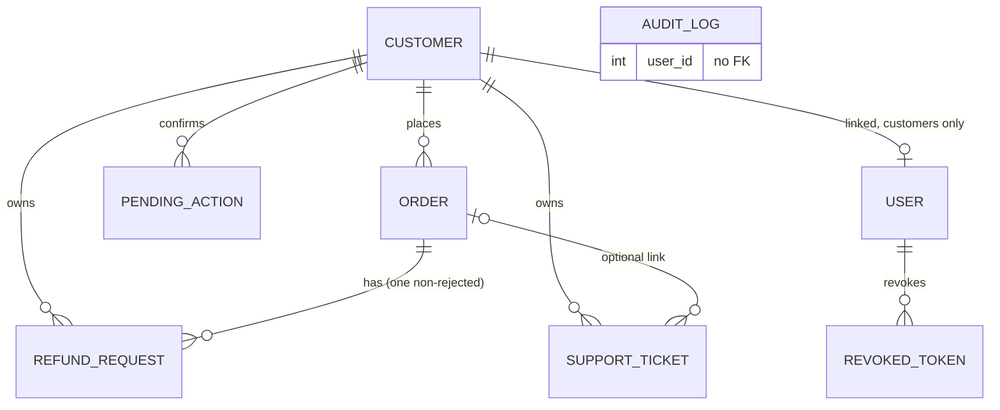
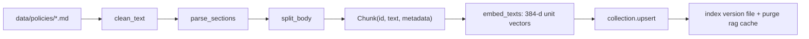
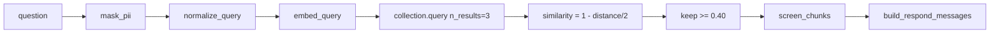
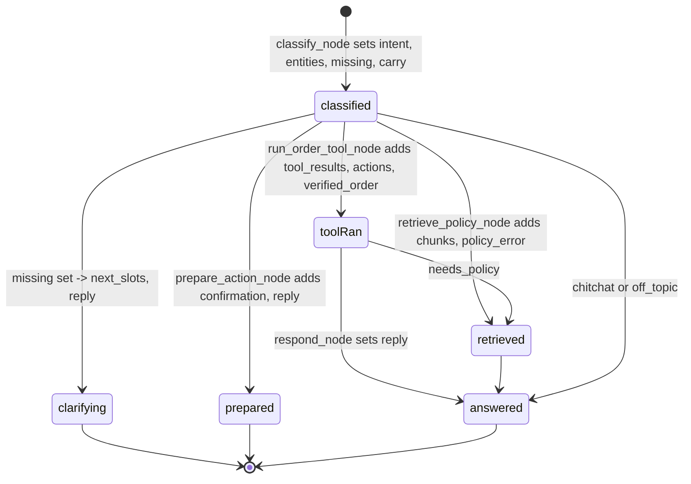
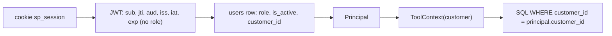

# 5. Data flow and transformations

## 5.1 Request/response models (frontend ↔ backend)
| Frontend (TypeScript) | Backend (Pydantic) | Notes |
|---|---|---|
| `AgentReply` in `frontend/src/types/chat.ts` | `backend/app/schemas/agent.py::AgentChatResponse` | `chatApi.ts` validates items with `isSource/isAction/isConfirmation` |
| `ConfirmationPrompt` | `schemas/agent.py::ConfirmationPrompt` | `expires_at` serialised with a trailing `Z` (`schemas/common.py::UtcDatetime`) |
| `ConfirmReply` | `schemas/agent.py::ConfirmResponse` | outcome enum |
| `Eligibility`, `CreateRefundOutput`, `ToolResult<T>` in `types/support.ts` | `schemas/refunds.py::EligibilityResult`, `schemas/tools.py::CreateRefundOutput`, `ToolResult` | tool endpoints return 404/409 bodies as `ToolResult` |
| `Profile` in `types/auth.ts` | `schemas/auth.py::ProfileOut` | no token in body |
Requests are validated by Pydantic before any code runs: `ConversationId` regex, `UserMessage` (1-2000 chars, stripped), tool inputs use `extra="forbid"` (a smuggled `customer_id` fails with 422).

Illustrative agent exchange (shape from the schemas; values illustrative):
```json
{"message": "Please submit a refund request for SP-1004, it was late.", "conversation_id": "a1b2c3d4-..."}
```
```json
{"reply": "The Express parcel is delayed beyond 2 business days. ... Nothing has been created yet; I'll only go ahead if you confirm.",
 "intent": "refund_request",
 "sources": [],
 "actions": [{"tool": "create_refund_request", "label": "Prepared refund request (awaiting your confirmation)", "ok": true}],
 "confirmation": {"id": "<uuid>", "kind": "refund_request", "title": "Submit a refund request for SP-1004?",
                  "details": ["Order: SP-1004", "Reason: Express parcel delivered late", "Refundable amount: $25.00", "..."],
                  "expires_at": "2026-11-05T10:12:00Z"}}
```

## 5.2 Database

Defined in `backend/app/models/entities.py`, `backend/app/models/auth.py`, `backend/app/models/pending_action.py`. Notable integrity: `ck_users_customer_link` (customers have a customer row, staff none), partial unique indexes `uq_refund_active_per_order` and `uq_open_ticket_per_order_category`, foreign keys enforced by the `PRAGMA foreign_keys=ON` listener in `database/session.py`. Money is integer cents; timestamps naive UTC.

## 5.3 RAG ingestion

Transformation example (text from the delivered policy; id observed):
| Stage | Value |
|---|---|
| Section | `## Reporting deadline` in `damaged_parcel_policy.md` |
| Chunk text | `SwiftParcel Damaged Parcel Policy - Reporting deadline\nA damaged SwiftParcel parcel must be reported within 48 hours of the delivery time shown in tracking. ...` |
| Chunk id | `damaged_parcel_policy-00-0` |
| Metadata | `{source, category: "damaged_parcel", title, section}` |
| Embedding | 384 floats, length 1 (observed shape `(n, 384)`) |

## 5.4 Retrieval and prompt construction

Message shape sent to Ollama by `backend/app/agent/prompts.py::build_respond_messages`:
```text
system:  AGENT_SYSTEM_PROMPT (+ canary line)
history: last 4 masked messages
user:    <policy_context>
         [1] damaged_parcel_policy.md - Reporting deadline
         SwiftParcel Damaged Parcel Policy - Reporting deadline
         A damaged SwiftParcel parcel must be reported within 48 hours ...
         </policy_context>

         Customer message: How long do I have to report a damaged parcel?
```
With tools, a `<tool_results>` block (humanised: `shipping_fee_usd: "$25.00"` instead of cents) precedes it.

## 5.5 LangGraph state transitions
`AgentState` (`backend/app/agent/state.py`) is a `TypedDict`; nodes return partial updates.

After the run, `run_agent_with_state` copies `next_slots` and `verified_order` into `MemoryStore`.

## 5.6 Tool inputs and outputs
All tools take a Pydantic input (`extra="forbid"`, no customer id) and return `ToolResult{ok, data, error{code,message}}` (`backend/app/schemas/tools.py`). Example data types: `TrackingOut`, `CustomerOrdersOutput`, `EligibilityResult`, `CreateRefundOutput{outcome, eligibility, status_if_created, refund_request}`, `CreateTicketOutput{outcome, preview, ticket}`. `outcome` is `confirmation_required`, `created` or `not_created`.

## 5.7 Authentication context and ownership

The browser can never supply a customer id, and the LLM never sees the principal.

## 5.8 Redis
| Namespace | Key | Value | TTL | Invalidation |
|---|---|---|---|---|
| embedding | `supportpilot:v1:embedding:<sha256[:32]>` of `model@revision|normalized query` | JSON list of 384 floats | `CACHE_TTL_EMBEDDING` | revision/model change (new keys), TTL, admin clear |
| rag | key of `model@revision|index version|k|threshold|query` | JSON list of chunk dicts | `CACHE_TTL_RAG` | index version changes at ingest + `clear_by_prefix("rag")`, TTL |
| llm (off by default) | key of model, prompt version, temperature, index version, chunk ids, history hash, query | reply string | `CACHE_TTL_LLM` | same plus `PROMPT_VERSION` |
Never stored: eligibility, authorization, tool results, tokens, customer data.