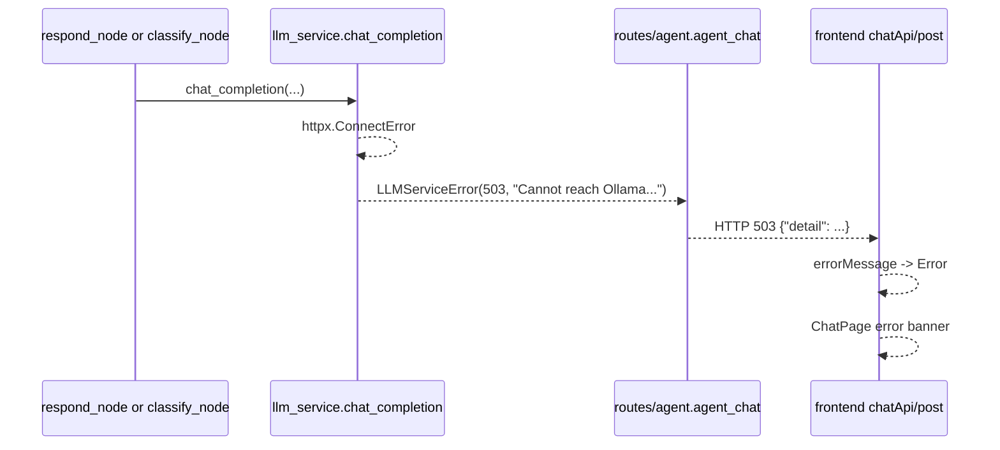
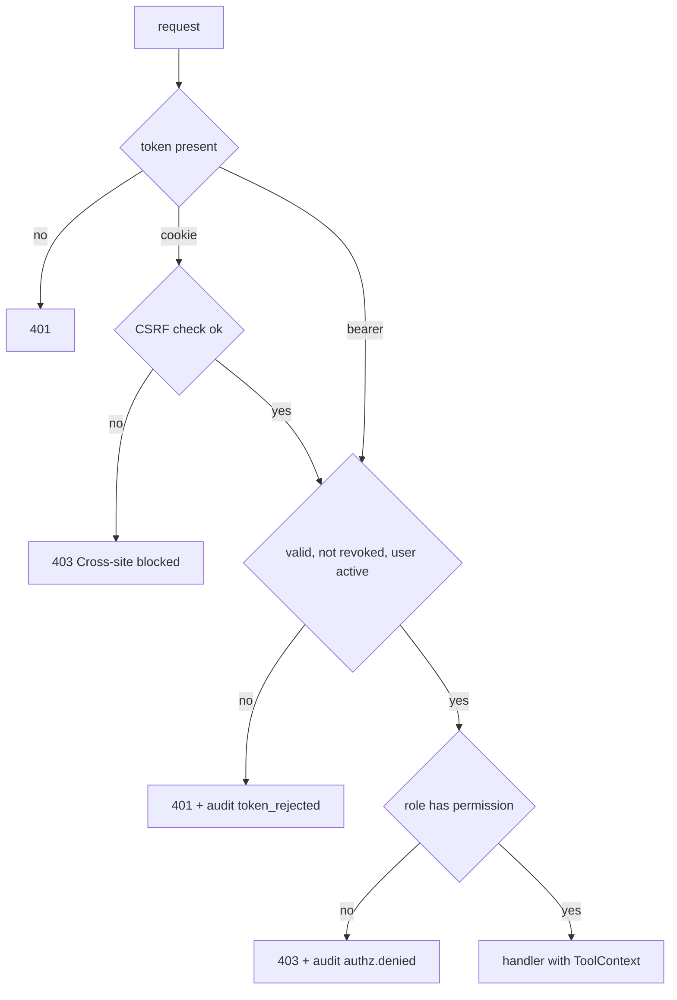
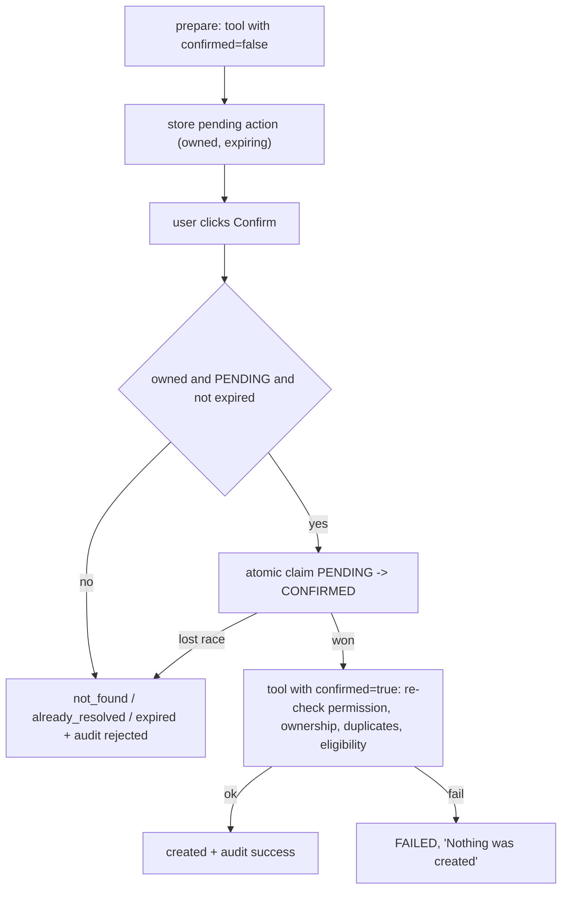
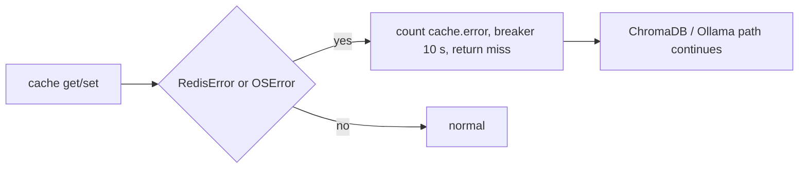

# 7. Error handling and security flows

## 7.1 Failure map
| Failure | Where it is raised / handled | Result |
|---|---|---|
| Request validation | FastAPI/Pydantic | 422; UI shows a generic validation message |
| Database error | `SQLAlchemyError` caught only in `backend/app/api/routes/agent.py` (503 + rollback); elsewhere falls to `main.py::unhandled_error` (500) | partial coverage |
| Ollama unreachable / timeout / 404 model | `llm_service.py::_service_error`, `_content` → `LLMServiceError` → `HTTPException` in `agent_chat` and `chat` | 503 / 504 / 503 |
| Malformed Ollama body | `_content` → `LLMServiceError(502)` | error banner |
| Malformed classification JSON | `nodes.py::_classify_with_llm` → `heuristic_intent` | normal reply |
| ChromaDB empty | `retrieve` raises `KnowledgeBaseEmptyError`; handled in `retrieve_policy_node` and legacy `chat` | "cannot verify" style answer / 503 |
| ChromaDB other errors | not caught in `retrieve_policy_node` | 500 (gap) |
| Redis unavailable | `CacheService._fail` | cache skipped, 10 s breaker |
| LangGraph failure | exceptions propagate; no loops, `recursion_limit` set | LLM errors as above, others 500 |
| MCP tool failure | tools return `{ok:false,error}`; SDK-level exception wrapping **unverified** | structured error |
| Authentication | `get_principal`, `login` | 401 generic |
| Authorization | `require_permission`, tool `_forbidden` | 403, audited |
| Ownership | `_owned_order`, `get_ticket`... | 404 identical to missing, audited as `record.access` denied |
| Duplicates | `DUPLICATE_REQUEST`/`DUPLICATE_TICKET` + partial unique indexes | 409 |
| Rate limit | `rate_limit_user`, `login` | 429 + `Retry-After` |
| Oversized body | `BodySizeLimitMiddleware` | 413 |

## 7.2 Ollama failure path

Note the confirmation endpoint uses no LLM, so a pending action can still be confirmed while Ollama is down.

## 7.3 Authentication and authorization path

## 7.4 Confirmation and duplicate prevention

The LLM never produces a confirmation, and a typed "yes" is not accepted.

## 7.5 Redis unavailable

## 7.6 Prompt-injection defences actually in the code
1. Identity and permissions never reach the model (`Principal` lives outside the prompt).
2. Tool arguments are built by regex/enums in `parsing.py` and validated by Pydantic; no free-form tool calls.
3. `ai_safety.sanitize_user_text` strips control/bidi/zero-width characters; `pii.mask_pii` masks prompts, retrieval queries and stored history.
4. Untrusted text is wrapped in tags and stripped of our tag strings (`prompts.py::neutralize`); retrieved chunks pass `screen_chunks` (heuristic).
5. Output: canary + verbatim-line leak check (`filter_reply`), token redaction, `guard_claims`.
6. Creation requires a server-side confirmation; eligibility is deterministic; a question cannot become a creation request (`_sanity_check_intent`).

## 7.7 PII handling
Masked before the LLM and before embedding; history stored masked; logs pass `install_redaction`; the request log contains no bodies or queries; staff views mask emails (`pii.mask_email`); audit rows store codes, ids and a hash of unknown emails. Ticket descriptions are stored as written.

## 7.8 Honest security gaps
- Audit write failures are logged, not blocking; audit and revocation live in the same SQLite file (not tamper-evident).
- Rate limiter and conversation memory are per process; `X-Forwarded-For` is only trusted if configured.
- Single shared HS256 secret, no rotation, refresh tokens, MFA, password reset or lockout.
- REST `confirmed: true` has no step-up authentication; the MCP token lives in a process environment variable.
- Photo count and refund reason are self-declared; classification can be wrong (sanity checks limit the damage).
- Chroma errors other than "empty" are unhandled; most DB errors outside the agent routes become generic 500s.
- Heuristic screens (chunk quarantine, PII regex) can miss variants. Development runs over plain HTTP with non-Secure cookies.
- No independent security review or penetration test was performed. See also `docs/06-security.md`.