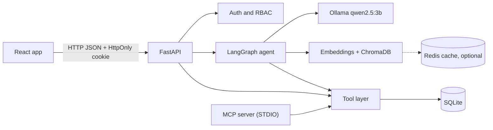

# Codebase guide (interview handbook)

Reverse-engineered documentation of what is **actually implemented** in this repository (Milestones 1-6). Existing application code is untouched.

> **Basis and limits.** Written from the code delivered during development, not from a scan of a working tree. Run `python docs/codebase-guide/verify_references.py` from the repo root to check every file and symbol reference against your copy. Milestone 6 (evaluation, Redis, tracing) behaviour is described from its code; its manual verification outputs were not available when this was written, so runtime claims there are marked **unverified**.

## Contents
| # | Document | Use it to |
|---|---|---|
| 1 | [System architecture](01-system-architecture.md) | See the components and how they connect |
| 2 | [End-to-end flows](02-end-to-end-flows.md) | Trace 15 real request paths function by function |
| 3 | [Codebase map](03-codebase-map.md) | Find any file, what it imports and who calls it |
| 4 | [Function-by-function](04-function-by-function.md) | Understand important functions in depth |
| 5 | [Data flow](05-data-flow.md) | Follow data shapes from the browser to the database and back |
| 6 | [Concepts and design decisions](06-concepts-and-design-decisions.md) | Explain the technologies and the trade-offs |
| 7 | [Error and security flows](07-error-and-security-flows.md) | Explain failure paths and honest security gaps |
| 8 | [Interview preparation](08-interview-preparation.md) | Practise questions, walkthroughs and follow-ups |

**Recommended order:** 1 → 2 → 5 → 3 → 4 → 6 → 7 → 8. Source links use relative paths such as [`nodes.py`](../../backend/app/agent/nodes.py). References written as `` `path::symbol` `` are machine-checked.

## High-level architecture

## Implementation status (verified against the delivered code)
| Area | Status |
|---|---|
| Chat agent, RAG, tools, confirmation, auth, RBAC, audit, staff and admin UI | Implemented |
| MCP server (STDIO) | Implemented; creation tools are prepare-only; third-party client testing **unverified** |
| Redis cache (embedding, retrieval) | Implemented, optional; runtime behaviour **unverified** here |
| LLM response cache | Implemented but **off by default** (`LLM_CACHE_ENABLED`) |
| Evaluation harness and benchmark | Implemented; **no results are recorded in the docs** |
| Reference-data cache (`reference` namespace) | **Not implemented** (deliberately) |
| Langfuse, async Redis, refresh tokens, MFA, password reset, containers, real payouts | **Not implemented** |
| `backend/app/ai/agent.py`, `evaluations/questions.json` | **Empty placeholders** from Milestone 1; the real agent lives in `backend/app/agent/` |
| `backend/app/schemas/orders.py::MeResponse` | Dead code left from the demo-identity era (unused) |

## Glossary
| Term | Meaning |
|---|---|
| Principal | `backend/app/security/principal.py::Principal`: the authenticated identity of one request (role read fresh from the database) |
| ToolContext | `backend/app/tools/support_tools.py::ToolContext`: db session + customer + principal + channel; the only way tools learn who is calling |
| Channel | `api`, `agent`, `mcp` or `eval`: where a tool call came from (recorded in audit) |
| Tool layer | The five functions in `support_tools.py` shared by REST, the agent and MCP |
| Intent | One of eight classifications in `backend/app/agent/state.py::Intent` |
| Slot filling / awaiting | Multi-turn collection of a missing value (order, reason, photos, description) via `nodes.py::_fill_awaiting` |
| Pending action | A stored, single-use, expiring confirmation (`backend/app/models/pending_action.py::PendingAction`) |
| Prepare-only | A creation path that previews and stores a pending action but never writes the record |
| Rule code | Stable machine-readable eligibility outcome, e.g. `DAMAGE_WINDOW_EXPIRED` |
| Scenario order | Hand-built seeded order (SP-1001...SP-1021, SP-3001) that exercises one rule |
| Index version | Hash of the indexed policy chunks; part of every RAG cache key |
| Quarantine | Dropping an instruction-like retrieved chunk before it reaches the prompt |
| Canary | Per-process marker in the system prompt; if it appears in a reply, the prompt leaked |
| Trace id | `t` + 15 hex characters generated per request (`X-Trace-Id` header and log line) |
| Span | A timed section (`llm.inference`, `rag.retrieve`, ...) recorded by `observability/metrics.py::span` |
| Breaker | 10-second pause in Redis use after an error (`cache/service.py::CacheService._fail`) |